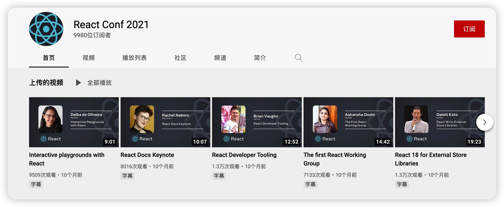
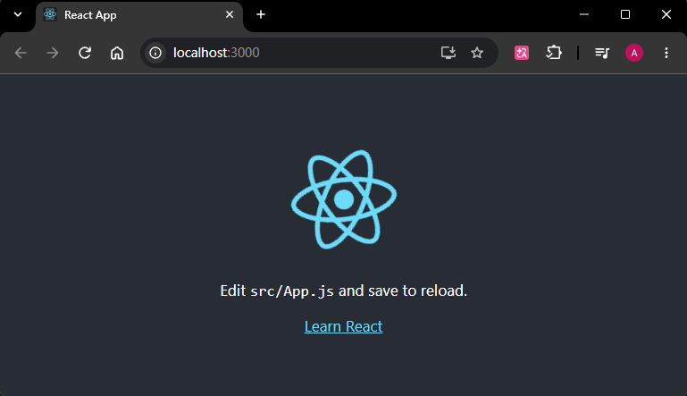
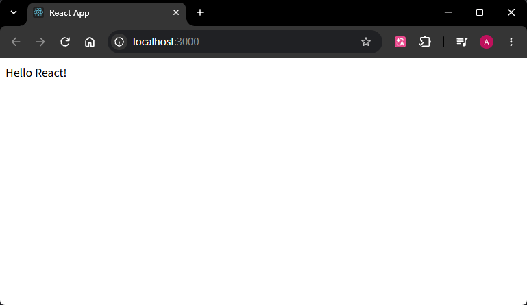
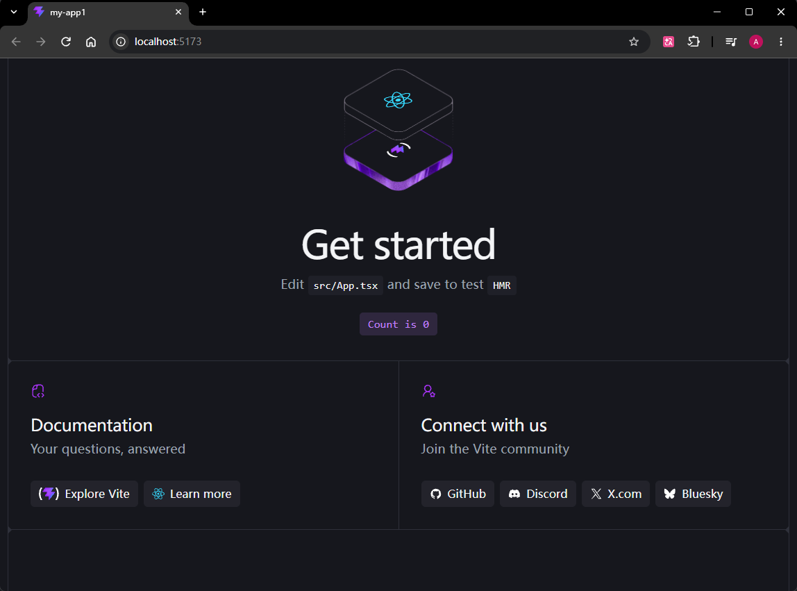

# 入门篇第一章第一节：*React* 基本介绍

本节录制时间：`2022-10-27 15:39`。

> 本章主要包含以下内容：
>
> - `React` 基本介绍
> - `React` 特点
> - 开发环境的搭建


## 1 React 基本介绍

`React` 起源于 `Facebook` 的内部项目，因为该公司对市场上所有 `JavaScript MVC` 框架都不满意，就决定自己写一套，用来架设 `Instagram` 的网站。

`React` 的实质：一个用于构建用户界面的 `JavaScript` 库。`React` 主要用于构建 `UI`。`React` 于 2013 年 5 月开源，由于拥有较高的性能，代码逻辑简单，越来越多的人已开始关注和使用它。

```math
UI = fn(state)
```

由于 `React` 的设计思想极其独特，属于革命性创新，性能出众，所以越来越多的人开始关注和使用，认为它可能是将来 `Web` 开发的主流工具。

这个项目本身也越滚越大，从最早的 `UI` 引擎变成了一整套前后端通吃的 `Web App` 解决方案。


> `React` 官网：https://reactjs.org/（学习时已更新为 https://react.dev/）


`React` 从诞生到现在，一直在给我们带来各种各样的惊喜。甚至从 2015 年开始，每年都会举行 *React Conf* 大会，介绍 `React` 本年度推出的新特性。



>*React Conf* 官网：*https://conf.reactjs.org/*
>
>*React Conf* 油管视频：*https://www.youtube.com/channel/UC1hOCRBN2mnXgN5reSoO3pQ*


下面介绍一下 `React` 几个重要版本的重大更新：

- `React 16` :出现了 `Fiber`，整个更新变的可中断、可分片、具有优先级

- `React 16.8`：推出了 `Hooks`，标志着从类组件正式转为函数式组件

- `React 17`：过渡版本，没有添加任何面向开发者的新功能，主要侧重于 **升级简化 React 本身**。

- `React 18`

  - `transition`

  - `Suspense`

  - 新的 `Hooks`

  - `Offscreen`

    …


## 2 React 的特点

`React` 官网主要罗列了三个特点（官网早已更新，当前最新版为 `v19.3`，且并未提到这三个特性）：

- 声明式
- 组件化
- 一次学习，跨平台编写


除此之外，`React` 还具有如下的特点：

- 单向数据流
- 虚拟 `DOM`
- `Diff` 算法


## 3 搭建开发环境

虽然官方提供了通过 `CDN` 引入 `React` 的方式：*https://zh-hans.reactjs.org/docs/cdn-links.html*（废弃）

但是实际开发中肯定是使用 `React` 的脚手架工具来搭建项目，`React` 官方提供了脚手架工具 `Create React App`（早古）：

https://create-react-app.dev/（最新脚手架文档：https://react.dev/learn/build-a-react-app-from-scratch）

快速开始：

```bash
# node: v21.1.0
npx create-react-app my-app
cd my-app
npm start
```

实测效果：



精简后（`diy_clean`）：




> ### 最新脚手架：通过 `vite` 构建
>
> 只需切换到 `Node.js v26.9.0`，执行命令：
>
> ```bash
> # node: v26.9.0
> npm create vite@latest my-app -- --template react-ts
> ```
>
> 根据提示选择 `Oxlint` 工具，并使用 `npm` 启动，新项目 `my-app` 会自动创建并启动。
>
> 实测结果：
>
> ```bash
> # 运行以下命令即可
> > npm create vite@latest my-app1 -- --template react-ts
> Need to install the following packages:
> create-vite@9.3.4
> Ok to proceed? (y) y
> 
> > npx
> > cva my-app1 --template react-ts
> 
> 
> create-vite v9.3.4
> 
> │
> ◇  Which linter to use?
> │  Oxlint   # 选择语法工具
> │
> ◇  Install with npm and start now?
> │  Yes      # 选择启动方式
> │
> ◇  Scaffolding project in E:\mydesktop\reactdemo1\my-app1...
> │
> ◇  Installing dependencies with npm...
> 
> added 28 packages in 7s
> 
> 9 packages are looking for funding
>   run `npm fund` for details
> │
> ◇  Starting dev server...
> 
> > my-app1@0.0.0 dev
> > vite
> 
> 
>   VITE v8.3.6  ready in 444 ms
> 
>   ➜  Local:   http://localhost:5173/
>   ➜  Network: use --host to expose
>   ➜  press h + enter to show help
> ```
>
> 用 `Chrome` 浏览器访问 `http://localhost:5173/`：
>
> 