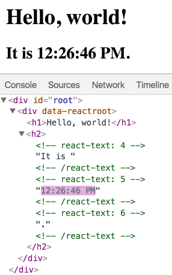

# 元素渲染

> 这些文档已经过时且不再更新，访问 [zh-hans.react.dev](https://zh-hans.react.dev/) 查看新的 React 文档。
>
> These new documentation pages teach how to write JSX and show it on an HTML page:
>
> - [Writing Markup with JSX](https://zh-hans.react.dev/learn/writing-markup-with-jsx)
> - [Add React to an Existing Project](https://zh-hans.react.dev/learn/add-react-to-an-existing-project#step-2-render-react-components-anywhere-on-the-page)

元素是构成 React 应用的最小砖块。

元素描述了你在屏幕上想看到的内容。

```
const element = <h1>Hello, world</h1>;
```

与浏览器的 DOM 元素不同，React 元素是创建开销极小的普通对象。React DOM 会负责更新 DOM 来与 React 元素保持一致。

> **注意：**
>
> 你可能会将元素与另一个被熟知的概念——“组件”混淆起来。我们会在[下一个章节](https://zh-hans.legacy.reactjs.org/docs/components-and-props.html)介绍组件。组件是由元素构成的。我们强烈建议你不要觉得繁琐而跳过本章节，应当深入阅读这一章节。

## 将一个元素渲染为 DOM

假设你的 HTML 文件某处有一个 `<div>`：

```
<div id="root"></div>
```

我们将其称为“根” DOM 节点，因为该节点内的所有内容都将由 React DOM 管理。

仅使用 React 构建的应用通常只有单一的根 DOM 节点。如果你在将 React 集成进一个已有应用，那么你可以在应用中包含任意多的独立根 DOM 节点。

想要将一个 React 元素渲染到根 DOM 节点中，只需把它们一起传入 [`ReactDOM.createRoot()`](https://zh-hans.legacy.reactjs.org/docs/react-dom-client.html#createroot)：


```
const root = ReactDOM.createRoot(
  document.getElementById('root')
);
const element = <h1>Hello, world</h1>;
root.render(element);
```


**[在 CodePen 上试试](https://codepen.io/gaearon/pen/ZpvBNJ?editors=1010)**

页面上会展示出 “Hello, world”。

## 更新已渲染的元素

React 元素是[不可变对象](https://en.wikipedia.org/wiki/Immutable_object)。一旦被创建，你就无法更改它的子元素或者属性。一个元素就像电影的单帧：它代表了某个特定时刻的 UI。

根据我们已有的知识，更新 UI 唯一的方式是创建一个全新的元素，并将其传入 `root.render()`。

考虑一个计时器的例子：


```
const root = ReactDOM.createRoot(
  document.getElementById('root')
);

function tick() {
  const element = (
    <div>
      <h1>Hello, world!</h1>
      <h2>It is {new Date().toLocaleTimeString()}.</h2>
    </div>
  );
  root.render(element);}

setInterval(tick, 1000);
```


**[在 CodePen 上试试](https://codepen.io/gaearon/pen/gwoJZk?editors=1010)**

这个例子会在 [`setInterval()`](https://developer.mozilla.org/en-US/docs/Web/API/WindowTimers/setInterval) 回调函数，每秒都调用 [`root.render()`](https://zh-hans.legacy.reactjs.org/docs/react-dom.html#render)。

> **注意：**
>
> 在实践中，大多数 React 应用只会调用一次 `root.render()`。在下一个章节，我们将学习如何将这些代码封装到[有状态组件](https://zh-hans.legacy.reactjs.org/docs/state-and-lifecycle.html)中。
>
> 我们建议你不要跳跃着阅读，因为每个话题都是紧密联系的。

## React 只更新它需要更新的部分

React DOM 会将元素和它的子元素与它们之前的状态进行比较，并只会进行必要的更新来使 DOM 达到预期的状态。

你可以通过查看 [上一个例子](https://codepen.io/gaearon/pen/gwoJZk?editors=1010) 来确认这一点。



尽管每一秒我们都会新建一个描述整个 UI 树的元素，React DOM 只会更新实际改变了的内容，也就是例子中的文本节点。

根据我们的经验，应该专注于 UI 在任意给定时刻的状态，而不是一视同仁地随着时间修改整个界面。


---


# Rendering Elements

> These docs are old and won’t be updated. Go to [react.dev](https://react.dev/) for the new React docs.
>
> These new documentation pages teach how to write JSX and show it on an HTML page:
>
> - [Writing Markup with JSX](https://react.dev/learn/writing-markup-with-jsx)
> - [Add React to an Existing Project](https://react.dev/learn/add-react-to-an-existing-project#step-2-render-react-components-anywhere-on-the-page)

Elements are the smallest building blocks of React apps.

An element describes what you want to see on the screen:

```react
const element = <h1>Hello, world</h1>;
```

Unlike browser DOM elements, React elements are plain objects, and are cheap to create. React DOM takes care of updating the DOM to match the React elements.

> **Note:**
>
> One might confuse elements with a more widely known concept of “components”. We will introduce components in the [next section](https://legacy.reactjs.org/docs/components-and-props.html). Elements are what components are “made of”, and we encourage you to read this section before jumping ahead.

## Rendering an Element into the DOM

Let’s say there is a `<div>` somewhere in your HTML file:

```react
<div id="root"></div>
```

We call this a “root” DOM node because everything inside it will be managed by React DOM.

Applications built with just React usually have a single root DOM node. If you are integrating React into an existing app, you may have as many isolated root DOM nodes as you like.

To render a React element, first pass the DOM element to [`ReactDOM.createRoot()`](https://legacy.reactjs.org/docs/react-dom-client.html#createroot), then pass the React element to `root.render()`:


```react
const root = ReactDOM.createRoot(
  document.getElementById('root')
);
const element = <h1>Hello, world</h1>;
root.render(element);
```


**[Try it on CodePen](https://codepen.io/gaearon/pen/ZpvBNJ?editors=1010)**

It displays “Hello, world” on the page.

## Updating the Rendered Element

React elements are [immutable](https://en.wikipedia.org/wiki/Immutable_object). Once you create an element, you can’t change its children or attributes. An element is like a single frame in a movie: it represents the UI at a certain point in time.

With our knowledge so far, the only way to update the UI is to create a new element, and pass it to `root.render()`.

Consider this ticking clock example:


```react
const root = ReactDOM.createRoot(
  document.getElementById('root')
);

function tick() {
  const element = (
    <div>
      <h1>Hello, world!</h1>
      <h2>It is {new Date().toLocaleTimeString()}.</h2>
    </div>
  );
  root.render(element);}

setInterval(tick, 1000);
```


**[Try it on CodePen](https://codepen.io/gaearon/pen/gwoJZk?editors=1010)**

It calls [`root.render()`](https://legacy.reactjs.org/docs/react-dom.html#render) every second from a [`setInterval()`](https://developer.mozilla.org/en-US/docs/Web/API/WindowTimers/setInterval) callback.

> **Note:**
>
> In practice, most React apps only call `root.render()` once. In the next sections we will learn how such code gets encapsulated into [stateful components](https://legacy.reactjs.org/docs/state-and-lifecycle.html).
>
> We recommend that you don’t skip topics because they build on each other.

## React Only Updates What’s Necessary

React DOM compares the element and its children to the previous one, and only applies the DOM updates necessary to bring the DOM to the desired state.

You can verify by inspecting the [last example](https://codepen.io/gaearon/pen/gwoJZk?editors=1010) with the browser tools:


Even though we create an element describing the whole UI tree on every tick, only the text node whose contents have changed gets updated by React DOM.

In our experience, thinking about how the UI should look at any given moment, rather than how to change it over time, eliminates a whole class of bugs.