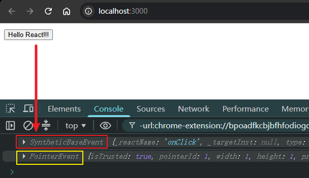
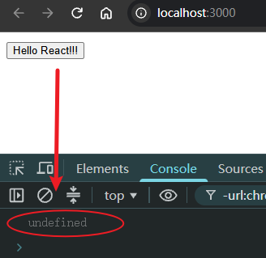
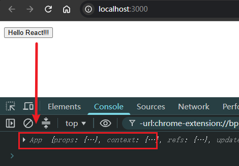
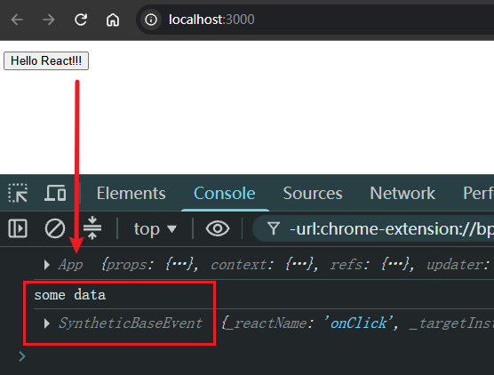
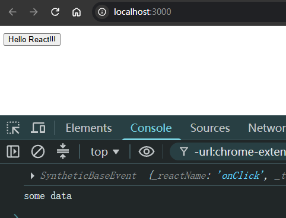

# Ch1S3P03：组件与事件绑定

录制时间：`2022-10-28 11:00`。

> 本节概要
>
> - `React` 中的组件
> - 为组件绑定事件
> - `this` 的指向
> - 向事件处理函数传参


## 1 React 中的组件

在 `React` 中，可以使用 **类** 的方式来声明一个组件：

```js
class 类名 extends React.Component {
  render(){
    return (
      // 一段 JSX
    )
  }
}
```

除了类组件，`React` 中还支持使用 **函数** 来创建组件，同样需要返回一段 `JSX`，来表示这个组件的 `UI` 是什么样的：

```js
function 组件名(){
  return (
  	// 一段 JSX
  );
}
```

**早期** 的函数组件被称之为 **无状态组件**，一般仅仅用来做纯 `UI` 展示，里面不会有复杂的逻辑。

但是从 `React 16.8` 推出 `Hooks` 概念后，现在更多使用函数组件了。

这不仅仅是语法的改变，同时也代表着整个 `React` 编程思想的一种转变。


## 2 为组件绑定事件

在 `React` 中绑定事件的写法如下：

```react
<button onClick={activateLasers}>Activate Lasers</button>
```

在 `React` 中无法通过 `return false` 来阻止默认行为，所以只有使用 `e.preventDefault` 的方式来阻止默认行为：

```react
function Form() {
  function handleSubmit(e) {
    e.preventDefault();
    console.log('You clicked submit.');
  }

  return (
    <form onSubmit={handleSubmit}>
      <button type="submit">Submit</button>
    </form>
  );
}
```

> [!note]
>
> **注意**
>
> `L2` 中的 `e` 不是原生的 `DOM` 事件对象，而是一个 **合成事件对象（*synthetic event*，输出到控制台显示类型为 SyntheticBaseEvent）**（详见 [文档](https://zh-hans.legacy.reactjs.org/docs/handling-events.html)）。
>
> `React` 中访问原生事件对象的方式：
>
> ```react
> eventHandler(e){
>   e.nativeEvent // 原生事件对象
> }
> ```
>
> 验证代码：
>
> ```react
> // App.js
> function App() {
>   const clickHandler = e => {
>     console.log(e);
>     console.log(e.nativeEvent)
>   }
>   const elem = <button onClick={clickHandler}>Hello React!!!</button>;
>   return ( elem );
> }
> 
> export default App;
> ```
>
> 实测效果：
>
> 

如果是类组件，那么事件处理函数写作一个类方法：

```react
class Welcome extends React.Component {
  // 事件处理函数
  eventHandler(e){
    window.alert('Hello');
    e.preventDefault();
  }
  
  render() {
    return (
      <a href="https://www.baidu.com/" onClick={this.eventHandler}>this is a test</a>
    );
  }
}
```


## 3 this 的指向

该问题仅存在于基于 `class` **类** 创建的 `React` 组件。

由于 `JS` 中 `this` 的特殊性，事件处理函数中的 `this` 并不会指向当前的组件：

```react
import React from 'react';

class App extends React.Component {
  clickHandler(e) {
    console.log(this);
  }
  
  render() {
    const elem = <button onClick={this.clickHandler}>Hello React!!!</button>;
    return ( elem );
  }
}

export default App;
```

实测结果：



这就需要我们自行对 `this` 进行指向的修正。有三种解决方案：

1. 将事件处理函数修改为 **箭头函数**
2. 将事件绑定修改为 **箭头函数**
3. 使用 `bind` 方法来强制绑定 `this` 的指向

实测1：将事件处理函数修改为 **箭头函数**：

```react
import React from 'react';

class App extends React.Component {
  // 1. 将事件处理函数修改为箭头函数
  clickHandler = (e) => {
    console.log(this);
  }
  
  render() {
    const elem = <button onClick={this.clickHandler}>Hello React!!!</button>;
    return ( elem );
  }
}

export default App;
```

实测2：将事件绑定修改为 **箭头函数**：

```react
import React from 'react';

class App extends React.Component {
  clickHandler(e) {
    console.log(this);
  }
  
  render() {
    // 2. 将事件绑定修改为箭头函数
    const elem = <button onClick={e => this.clickHandler()}>Hello React!!!</button>;
    return ( elem );
  }
}

export default App;
```

实测3：使用 `bind` 方法来强制绑定 `this` 的指向：

```react
import React from 'react';

class App extends React.Component {
  clickHandler(e) {
    console.log(this);
  }
  
  render() {
    // 3. 使用 bind 方法来强制绑定 this 的指向
    const elem = <button onClick={this.clickHandler.bind(this)}>Hello React!!!</button>;
    return ( elem );
  }
}

export default App;
```

上述三种方式均可访问到期望的 `this`：




## 4 向事件处理程序传参

另外还有一个非常重要的问题，就是如何向事件处理函数传递参数。

如果要传递参数，可以使用下面的两种方式来进行传参：

- 通过 `bind` 方法在绑定 `this` 指向时向事件处理函数进行传参
- 绑定事件时，通过书写 **箭头函数** 的形式来传参

实测1：通过 `bind` 传参：

```react
import React from 'react';

class App extends React.Component {
  clickHandler(data, e) {
    console.log(this);
    console.log(data);
    console.log(e);
  }
  
  render() {
    // 1. 通过 bind 方法在绑定 this 指向时向事件处理函数进行传参
    const elem = <button onClick={this.clickHandler.bind(this, "some data")}>Hello React!!!</button>;
    return ( elem );
  }
}

export default App;
```



实测2：通过箭头函数传参：

```react
import React from 'react';

class App extends React.Component {
  clickHandler(e, data) {
    console.log(e);
    console.log(data);
  }
  
  render() {
    // 2. 通过书写箭头函数的形式来传参
    const elem = <button onClick={e => this.clickHandler(e, "some data")}>Hello React!!!</button>;
    return ( elem );
  }
}

export default App;

```



小结：`React` 的事件对象 `e` 在箭头函数中必须显式声明和调用；而在 `bind` 方案中是隐式传入（紧跟显式传参的后面）。


## 5 作业

通读 `React` 官方文档：[事件处理](https://zh-hans.legacy.reactjs.org/docs/handling-events.html)（内容另存为 `doc1_handling_events.md`）。