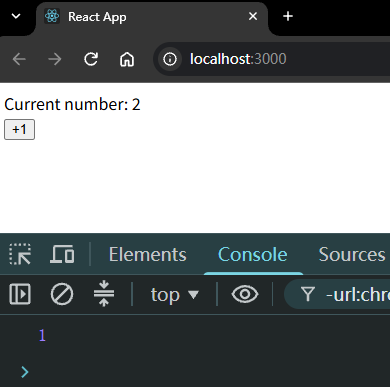
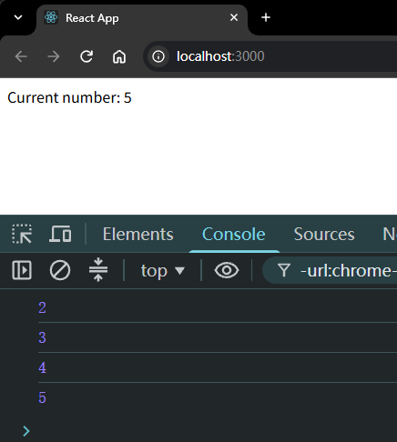
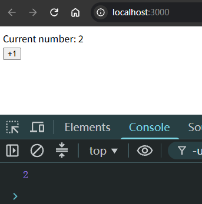
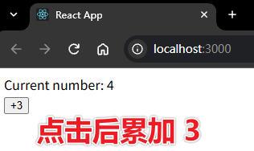
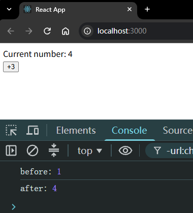
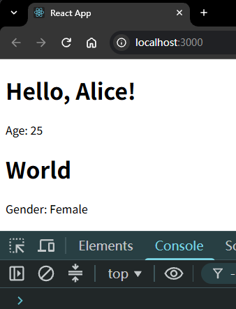
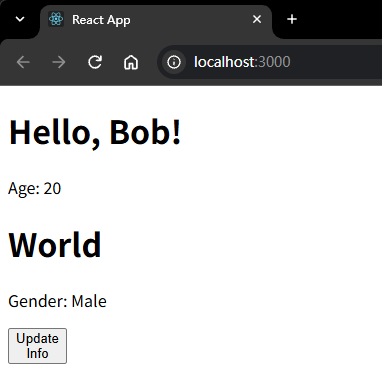
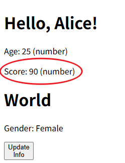
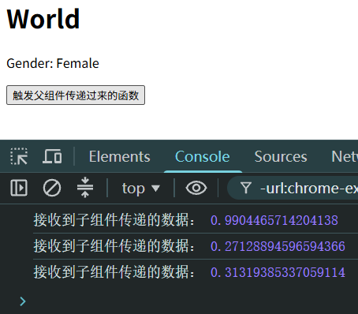

# Ch1S4P04：组件状态与数据传递

录制：`2022-10-28 15:49`。

> 本节该要：
>
> - 组件状态
> - `props`
> - `props` 验证
> - 状态提升
>
> 参考文档：[https://zh-hans.legacy.reactjs.org/docs/state-and-lifecycle.html](https://zh-hans.legacy.reactjs.org/docs/state-and-lifecycle.html)


## 1 组件状态

早期类组件被称之为 **有状态组件**，就是因为在类组件中能够维护组件数据（类似 `Vue2` 中的 `data`）：

```js
class 类名 extends React.Component{
  constructor(){
    super();
    // 设置组件自身的数据状态
    this.state = {
      xxx: xxx
    }
  }
  render(){
    return (
      // 通过 {this.state.xxx} 来获取状态数据
    )
  }
}

// 或者
class 类名 extends React.Component{
  state = {
      xxx : xxx
  }
  render(){
    return (
    	// 通过 {this.state.xxx} 来获取状态数据
    )
  }
}
```

不要直接去修改状态值，而是应该通过 `setState` 方法修改组件的 `state` 状态数据：

```js
this.setState({
  xxx: 新值
})
```

`setState` 对状态的改变 **可能** 是异步的。

> [!tip]
>
> （根据源码）如果状态的变更逻辑处于某个 `HTML` 元素的事件中，则该变更是异步的；否则是同步的（仅适用于 `React 17`，对 `React 18` 已不再适用）。
>
> 验证（`1e9f002`）：
>
> ```react
> import React from 'react';
> 
> class App extends React.Component {
>   state = {
>     num: 1
>   }
> 
>   handleClick = () => {
>     this.setState({
>       num: this.state.num + 1
>     })
>     console.log(this.state.num);
>   }
> 
>   render() {
>     return (
>       <>
>         <div>Current number: {this.state.num}</div>
>         <button onClick={this.handleClick}>+1</button>
>       </>
>     )
>   }
> }
> 
> export default App;
> ```
>
> 实测结果：
>
> 
>
> 本地验证时的 `React` 版本为 `19`，因此视频中的验证同步的代码并不能证明上述说法。
>
> 视频代码（废）：
>
> ```react
> import React from 'react';
> 
> class App extends React.Component {
>   
>   state = {
>     num: 1
>   }
> 
>   constructor(props) {
>     super(props);
>     this.timer = setInterval(() => {
>       this.setState({
>         num: this.state.num + 1
>       })
>       console.log(this.state.num);  // V18 后，始终比渲染值少 1，仍为异步
>       if(this.state.num >= 10) {
>         clearInterval(this.timer);
>       }
>     }, 1000)
>   }
> 
>   render() {
>     return (
>       <>
>         <div>Current number: {this.state.num}</div>
>       </>
>     )
>   }
> }
> 
> export default App;
> ```
>
> 更正版：利用 `setState` 的第二个参数（回调函数）进行验证（`9994af6`）：
>
> ```react
> import React from 'react';
> 
> class App extends React.Component {
>   
>   state = {
>     num: 1
>   }
> 
>   constructor(props) {
>     super(props);
>     this.timer = setInterval(() => {
>       this.setState({ num: this.state.num + 1 },
>       () => {
>         console.log(this.state.num)  // 这里拿到的是更新后的值
>         if(this.state.num >= 5) {
>           clearInterval(this.timer)
>         }
>       }
>     )}, 1000)
>   }
> 
>   render() {
>     return (
>       <>
>         <div>Current number: {this.state.num}</div>
>       </>
>     )
>   }
> }
> 
> export default App;
> ```
>
> 实测结果（确为同步）：
>
> 

要想在事件处理函数里拿到 `setState` 执行后的数据，可以提前使用一个变量来存储计算结果；或者使用 `setState` 的第二个参数：它是一个函数，这个函数会在 `state` 更新后被调用。

本地验证（`cba3461`）：

```react
// 1. 使用变量
clickHandler = () => {
  const newNum = this.state.num + 1;
  this.setState({ num: newNum });
  console.log(newNum);
}

// 2. 使用回调
clickHandler = () => {
  this.setState(
    { num: this.state.num + 1 }, 
    () => console.log(this.state.num));
}
```

实测结果均为：



`setState` 最佳实践：

1. 把所有的 `setState` 当作是 **异步的**（`V18` 后已经统一为异步）；
2. 永远不要信任 `setState` 调用之后的状态；
3. 如果要使用改变之后的状态，需要使用回调函数（`setState` 的第二个参数）；
4. 如果新的状态要根据之前的状态进行运算，使用函数的方式改变状态（`setState` 的第一个函数）；

```react
this.setState(function(state, props) {
  return {
    counter: state.counter + props.increment
  };
});
```

因此，连续累加三次的正确写法为（`b2cf036`）：

```react
// 1. 一参为函数形式
clickHandler = () => {
  Array.from({length: 3}, _ => this.setState(
    prevState => ({num: prevState.num + 1})));
}

// 2. 利用二参回调形式（不推荐）
clickHandler = () => {
  this.setState({num: this.state.num + 1},
    () => this.setState({num: this.state.num + 1},
      () => this.setState({num: this.state.num + 1})
    )
  );
} 
```

实测结果：




`React` 会对异步的 `setState` 进行优化，将多次 `setState` 进行合并（将多次状态改变完成后，再统一对 `state` 进行改变，然后触发 `render`）。

本地验证（`28455ff`）：

```react
clickHandler = () => {
  this.setState(prevState => ({num: prevState.num + 1}))
  this.setState(prevState => ({num: prevState.num + 1}), () => console.log('after:', this.state.num))
  this.setState(prevState => ({num: prevState.num + 1}))

  console.log('before:', this.state.num);
}
render() {
  return (
    <>
      <div>Current number: {this.state.num}</div>
      <button onClick={this.handleClick}>+3</button>
    </>
  )
}
```

执行结果：`setState` 的第二参数（回调）中的状态值是合并后的最终结果——




## 2 props

和 `Vue` 一样，在 `React` 中组件会存在层级关系，那么自然会涉及到组件之间进行数据的传递。

如果是父组件向子组件传递数据，则使用 `props`。

如果是函数组件，`props` 作为函数的一个参数传入：

```react
function 组件名(props) {
  return (
    // 一段 JSX
    // 通过 props.xxx 获取传入的值
    <div>
      <p>姓名：{props.name}</p>
      <p>年龄：{props.age}</p>
      <p>性别：{props.gender}</p>   
    </div>
  );
}
```

如果是类组件，则需要在 `constructor` 中将 `props` 通过 `super` 传递给父类，然后通过 `this.props` 的方式来获取传入的值：

```react
class 组件名 extends React.Component {
  constructor(props) {
    super(props);
  }
  render() {
    return (
       // 一段 JSX
    	 // 通过 this.props.xxx 获取传入的值
        <div>
          <p>姓名：{this.props.name}</p>
          <p>年龄：{this.props.age}</p>
          <p>性别：{this.props.gender}</p>   
        </div>
     );
	}
}
```

实测效果（`4d3dced`）：



通过 `props.children`，可以实现类似于 `Vue` 中插槽的功能，例如：

```react
class 组件B extends React.Component{
  constructor(props){
    super(props);
  }
  render(){
    return (
      <div>
          {this.props.children}
      </div>
    );
  }
}
class 组件A extends React.Component{
  constructor(props){
    super(props);
  }
  render(){
    return (
      <组件B>
        <p>Hello, React</p>
        <p>Hello, Redux</p>
        <p>Hello, Facebook</p>
        <p>Hello, Google</p>
      </组件B>
    );
  }
}
```

实测 `Button` 组件（`40008bf`）：

```react
// Button.jsx
function Button(props) {
  return <>
    <button onClick={props.onClick}>{props.children}</button>
  </>;
}
export default Button;

// App.js
class App extends React.Component {

  state = {
    name: 'Alice',
    age: 25,
    gender: 'Female'
  }

  render() {
    return (
      <>
        <Hello stuInfo={this.state} />
        <World stuInfo={this.state} />
        <Button onClick={() => this.setState({ name: 'Bob', age: 20, gender: 'Male' })}>
          <div>Update</div>
          <div>Info</div>
        </Button>
      </>
    )
  }
}
```

按钮效果：



关于传入组件的值的类型：

- `<Comp prop1="18">`：传入的是字符串 `"18"`；
- `<Comp prop1={this.state.age}>`：当 `state = {age: 18}` 时，传入的是数字 `18`

实测代码（`f97d4ed`）：

```react
state = {
  name: 'Alice',
  age: 25,
  gender: 'Female',
  score: 90
}

render() {
  const {name, age, gender} = this.state;
  const stuInfo = {name, age, gender}
  return (
    <>
      <Hello stuInfo={stuInfo} score={this.state.score} />
    </>
  )
}
```

效果：




## 3 props 验证

在 `Vue` 中，可以对传入的 `props` 设置默认值，并且验证 `props` 的有效性；在 `React` 中，针对 `props` 的默认值也可以通过 `defaultProps` 实现：

```react
function Greeting(props) {
  const { name, age, gender } = props;
  return (
    <div>
      <p>姓名：{name}</p>
      <p>年龄：{age}</p>
      <p>性别：{gender}</p>   
    </div>
   );
}
// 设置默认的 props 值，当组件没有传值时会使用默认值
Greeting.defaultProps = {
  name : 'xiejie',
  age : 18,
  gender : 'male'
};
```

```react
class Greeting extends React.Component {
  constructor(props) {
    super(props);
  }
  // 设置默认的 defaultProps 属性值
  static defaultProps = {
    name : "xiejie",
    age : 18,
    gender : 'male' 
  }
  render() {
    return (
      <div>
        <p>姓名：{this.props.name}</p>
        <p>姓名：{this.props.age}</p>
        <p>姓名：{this.props.gender}</p>
      </div>
    );
  }
}
// 或者
Greeting.defaultProps = {
    name : "xiejie",
    age : 18,
    gender : 'male' 
}
```

关于 `props` 的类型检查，从 `React v15.5` 版本开始，移入到了 `prop-types` 库：

```react
import PropTypes from 'prop-types';

class Greeting extends React.Component {
  render() {
    return (
      <h1>Hello, {this.props.name}</h1>
    );
  }
}

Greeting.propTypes = {
  name: PropTypes.string
};
```

```react
import PropTypes from 'prop-types'

function HelloWorldComponent({ name }) {
  return (
    <div>Hello, {name}</div>
  )
}

HelloWorldComponent.propTypes = {
  name: PropTypes.string
}

export default HelloWorldComponent
```

具体用法详见 [prop-types 在 npm 中的文档](https://zh-hans.legacy.reactjs.org/docs/state-and-lifecycle.html)，也可参考离线版 `doc1_prop_types.md`。


## 4 状态提升

在 `Vue` 中，父传子通过 `props`，子传父通过触发 **自定义事件**。

在 `React` 中，如果子组件需要向父组件传递数据，同样是通过 **触发父组件传递给子组件的事件** 来进行传递。

这在官网中被称之为“状态提升”：https://zh-hans.reactjs.org/docs/lifting-state-up.html

课堂案例（`7d968af`）：让子组件 `World` 调用父组件 `App` 传来的响应逻辑，并打印子传父的数据——

```react
// App.js
changeHandler = (data) => {
  console.log('接收到子组件传递的数据：', data);
}
render() {
  const {name, age, gender} = this.state;
  const stuInfo = {name, age, gender}
  return (<>
    <World stuInfo={stuInfo} change={this.changeHandler} />
  </>)
}

// component/World.jsx
clickHandler = () => {
  const data = Math.random();
  this.props.change(data)
}
render() {
  return (
    <div>
      <h1>World</h1>
      <p>Gender: {this.props.stuInfo.gender}</p>
      <button onClick={this.clickHandler}>触发父组件传递过来的函数</button>
    </div>
  );
}
```

效果：




## 5 React 文档阅读任务

核心概念——

- （必看）[4. 组件 & Props](https://zh-hans.legacy.reactjs.org/docs/components-and-props.html)（或查看 `doc2_comp_and_props.md`）
- （必看）[5. State & 生命周期](https://zh-hans.legacy.reactjs.org/docs/state-and-lifecycle.html)（或查看 `doc3_state_and_lifecycle.md`）
- （必看）[10. 状态提升](https://zh-hans.legacy.reactjs.org/docs/lifting-state-up.html)（或查看 `doc4_lifting_state_up.md`）
- （自学）[7. 条件渲染](https://zh-hans.legacy.reactjs.org/docs/conditional-rendering.html)（或查看 `doc5_conditional_rendering.md`）
- （自学）[8. 列表 & Key](https://zh-hans.legacy.reactjs.org/docs/lists-and-keys.html)（或查看 `doc6_lists_and_keys.md`）

> [!important]
>
> `useEffect` 存在竞态条件时的控制方法（`L9`、`L13`、`L16`）：
>
> ```react
> import { useState, useEffect } from 'react';
> import { fetchBio } from './api.js';
> 
> export default function Page() {
>   const [person, setPerson] = useState('Alice');
>   const [bio, setBio] = useState(null);
> 
>   useEffect(() => {
>     let allow = true
> 
>     setBio(null);
>     fetchBio(person).then(result => {
>       allow && setBio(result);
>     });
> 
>     return () => allow = false
>   }, [person]);
> 
>   return (
>     <>
>       <select value={person} onChange={e => {
>         setPerson(e.target.value);
>       }}>
>         <option value="Alice">Alice</option>
>         <option value="Bob">Bob</option>
>         <option value="Taylor">Taylor</option>
>       </select>
>       <hr />
>       <p><i>{bio ?? '加载中……'}</i></p>
>     </>
>   );
> }
> ```
>
> 出处：[脱围机制：使用 Effect 进行同步-挑战4](https://zh-hans.react.dev/learn/synchronizing-with-effects#challenges)


---

汇率转换案例（本课未讲解）：

父组件：

```react
import React from "react";
import Money from "./component/Money";

// 类组件
class App extends React.Component {
  state = {
    dollar: "",
    rmb: ""
  }

  transformToRMB = (value) => {
    if (parseFloat(value) || value === "" || parseFloat(value) === 0) {
      this.setState({
        dollar: value,
        rmb: value === "" ? "" : (value * 7.3255).toFixed(2)
      })
    } else {
      alert("请输入数字");
    }
  }

  transformToDollar = (value) => {
    if (parseFloat(value) || value === "" || parseFloat(value) === 0) {
      this.setState({
        dollar: value === "" ? "" : (value * 0.1365).toFixed(2),
        rmb: value
      })
    } else {
      alert("请输入数字");
    }
  }

  render() {
    return (
      <div>
        <Money text="美元" money={this.state.dollar} transform={this.transformToRMB} />
        <Money text="人民币" money={this.state.rmb} transform={this.transformToDollar} />
      </div>
    )
  }

}

export default App;
```

子组件：

```react
import React from 'react';

function Money(props) {
    function handleChange(e){
       // 在子组件中，要做的事情很简单，将用户数据的值，传递给父组件
       // 让父组件来进行修改
       props.transform(e.target.value);
    }
    return (
        <fieldset>
            <legend>{props.text}</legend>
            <input type="text" value={props.money} onChange={handleChange}/>
        </fieldset>
    );
}

export default Money;
```

