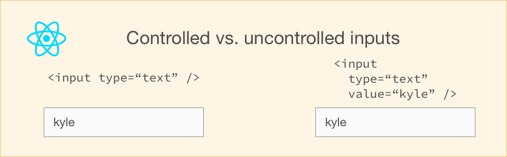
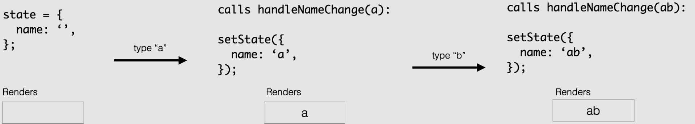

## [Controlled and uncontrolled form inputs in React don't have to be complicated](https://goshacmd.com/controlled-vs-uncontrolled-inputs-react/)



You may have seen many articles saying **"you shouldn't use `setState`,"** and the docs are claiming **"`ref`s are bad"**... That is so contradictory. It's hard to understand how to "get it right" and even what are the criteria for choosing.

How the hell are you supposed to make forms?

After all, forms *are* central to many web apps out there. And yet, form handling in React seems to be a bit of a... corner stone?

Fear no more. Let me show you the differences between the approaches, as well as when you should use each.

## The Uncontrolled

**Uncontrolled inputs** are like traditional HTML form inputs:

```jsx
class Form extends Component {
  render() {
    return (
      <div>
        <input type="text" />
      </div>
    );
  }
}
```

They remember what you typed. You can then get their value using [a ref](https://facebook.github.io/react/docs/refs-and-the-dom.html). For example, in `onClick` handler of a button:

```jsx
class Form extends Component {
  handleSubmitClick = () => {
    const name = this._name.value;
    // do something with `name`
  };

  render() {
    return (
      <div>
        <input type="text" ref={(input) => (this._name = input)} />
        <button onClick={this.handleSubmitClick}>Sign up</button>
      </div>
    );
  }
}
```

In other words, **you have to 'pull' the value from the field when you need it**. This can happen when the form is submitted.

That is the simplest way to implement the form inputs. There certainly are valid cases for using it: in simple forms in the real world; and when learning React.

It's not as powerful, though, so let's see those controlled inputs next.

*For what it's worth, I'm giving away two chapters of my book about forms. Get it below if you want; and continue reading the article.*


## The Controlled

A **controlled input** accepts its current value as a prop, as well as a callback to change that value. You could say it's a more "React way" of approaching this (which doesn't mean you should **always** use it).

```jsx
<input value={someValue} onChange={handleChange} />
```

Which is fine and all... but the value of this input *has* to live in the `state` somewhere. Typically, the component that renders the input (aka the form component) saves that in its `state`:

```jsx
class Form extends Component {
  constructor() {
    super();
    this.state = {
      name: "",
    };
  }

  handleNameChange = (event) => {
    this.setState({ name: event.target.value });
  };

  render() {
    return (
      <div>
        <input type="text" value={this.state.name} onChange={this.handleNameChange} />
      </div>
    );
  }
}
```

(Of course, it can be in the state of another component, or even in the separate state store, [like Redux](https://goshacmd.com/should-i-put-form-state-into-redux/).)

Every time you type a new character, `handleNameChange` is called. It takes in the new value of the input and sets it in the state.



- It starts out as an empty string — `''`.
- You type `a` and `handleNameChange` gets an `a` and calls `setState`. The input is then re-rendered to have the value of `a`.
- You type `b`. `handleNameChange` gets the value of `ab` and sets that to the state. The input is re-rendered once more, now with `value="ab"`.

**This flow kind of 'pushes' the value changes to the form component**, so the `Form` component always has the current value of the input, without needing to ask for it explicitly.

This means your data (state) and UI (inputs) are always in sync. The state gives the value to the input, and the input asks the `Form` to change the current value.

This also means that the form component can respond to input changes immediately; for example, by:

- in-place feedback, like validations
- [disabling the button unless all fields have valid data](https://goshacmd.com/form-recipe-disable-submit-button-react/)
- enforcing a specific input format, like credit card numbers

But if you don't need any of that and consider uncontrolled to be simpler, go for it.

### What makes an element "controlled"

There are other form elements, of course. You have checkboxes and radios and `select`s and textareas.

A form element becomes "controlled" if you set its value via a prop. That's all.

Each of the form elements, though, has a different prop for setting that value, so here's a little table to summarize:

| Element                     | Value property         | Change callback | New value in the callback |
| --------------------------- | ---------------------- | --------------- | ------------------------- |
| `<input type="text" />`     | `value="string"`       | `onChange`      | `event.target.value`      |
| `<input type="checkbox" />` | `checked={boolean}`    | `onChange`      | `event.target.checked`    |
| `<input type="radio" />`    | `checked={boolean}`    | `onChange`      | `event.target.checked`    |
| `<textarea />`              | `value="string"`       | `onChange`      | `event.target.value`      |
| `<select />`                | `value="option value"` | `onChange`      | `event.target.value`      |

## Conclusion

Both the controlled and uncontrolled form fields have their merit. **Evaluate your specific situation and pick the approach** — what works for you is good enough.

If your form is incredibly simple in terms of UI feedback, uncontrolled with refs is entirely fine. You don't have to listen to what the various articles are saying is "bad."

|                           feature                            | uncontrolled | controlled |
| :----------------------------------------------------------: | :----------: | :--------: |
|          one-time value retrieval (e.g. on submit)           |      ✅       |     ✅      |
| [validating on submit](https://goshacmd.com/submit-time-validation-react/) |      ✅       |     ✅      |
| [instant field validation](https://goshacmd.com/instant-form-fields-validation-react/) |      ❌       |     ✅      |
| [conditionally disabling submit button](https://goshacmd.com/form-recipe-disable-submit-button-react/) |      ❌       |     ✅      |
|                    enforcing input format                    |      ❌       |     ✅      |
|             several inputs for one piece of data             |      ❌       |     ✅      |
|  [dynamic inputs](https://goshacmd.com/array-form-inputs/)   |      ❌       |     ✅      |

Also, this is not an once-and-for-all decision: you can always migrate to controlled inputs. [Going from uncontrolled to controlled inputs is not hard](https://goshacmd.com/turn-uncontrolled-into-controlled/).

Finally, here's [the organized list of my posts about forms in React](https://goshacmd.com/on-forms-react/).

## References

- [Forms page on the official React docs](https://facebook.github.io/react/docs/forms.html)
- [Supported events](https://facebook.github.io/react/docs/events.html)
- [Refs](https://facebook.github.io/react/docs/refs-and-the-dom.html)