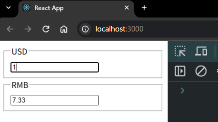
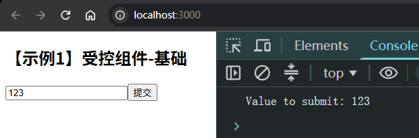
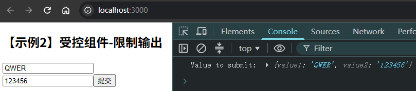
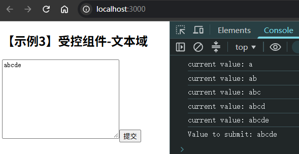
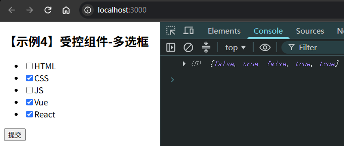
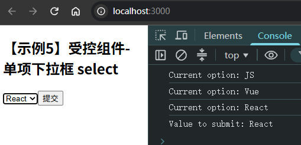
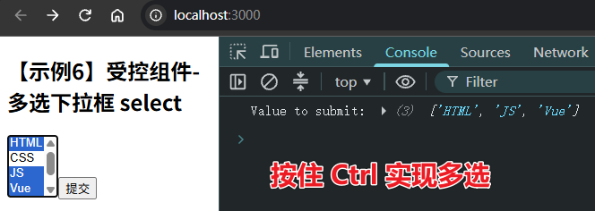
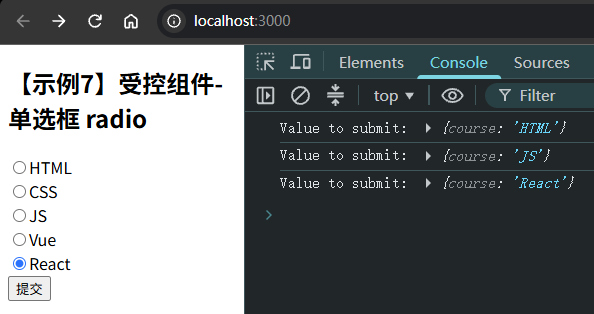

# Ch1S5P05：React 表单

> 本节概要：
>
> - 状态提升案例（续上节）
> - 受控组件
> - 非受控组件


## 1 状态提升案例

通过一个汇率转换的示例加深对 `React` 状态提升的理解。

需求描述：依照汇率数据，设计一个 `Money` 组件，传入币种、货币值、转换公式，然后在父组件成对使用 `Money` 组件，实现人民币和美元币值的互换计算。汇率数据如下：

|        时间         | 美元 兑 人民币 | 人民币 兑 美元 |
| :-----------------: | :------------: | :------------: |
| 2022 年 11 月 1 日  |    `7.3255`    |    `0.1365`    |
| 2026 年 11 月 10 日 |    `6.6708`    |    `0.1499`    |

最终效果：



核心逻辑：

```react
// component/Money.jsx
class Money extends Component {
  changeHandler = (e) => {
    this.props.convert(e.target.value);
  };

  render() {
    return (
      <fieldset>
        <legend>{this.props.currency}</legend>
        <input
          type="text"
          value={this.props.value}
          onChange={this.changeHandler}
        />
      </fieldset>
    );
  }
}

// App.js
class App extends Component {
  state = {
    usd: "",
    rmb: "",
  };

  usd2Rmb = (usd) => {
    if(isNaN(parseFloat(usd)) || usd === "" || parseFloat(usd) < 0) {
      alert('Please enter a valid number greater than or equal to 0');
      return;
    }

    this.setState({
      usd,
      rmb: exchange(usd, USD2RMB_RATE),
    });
  }

  rmb2Usd = (rmb) => {/* -- snip -- */}

  render() {
    return (
      <>
        <Money currency="USD" value={this.state.usd} convert={this.usd2Rmb}/>
        <Money currency="RMB" value={this.state.rmb} convert={this.rmb2Usd}/>
      </>
    );
  }
}
```

> [!tip]
>
> 上述实现不符合 `React` 最佳实践，不应保留两个币种的数额，而是每次更新正在编辑的币种和币值（另一种的币种、币值可以通过汇率计算得出）。
>
> 具体实现详见 `code/diy/currency_pro/` 文件夹。


## 2 受控组件

（从 `00:24:40` 开始）

参考文档：[9. 表单](https://zh-hans.legacy.reactjs.org/docs/forms.html)

无论是学习 `Vue`，还是 `React`，最重要的是要转换思想，这一步非常重要，往往也比较困难。

在以前 `jQuery` 时代，开发人员需要获取到 `DOM` 节点，然后进行操作。而在现代前端开发中，采用的是 `MVVM` 的模式，将视图和视图模型进行绑定，视图模型的改变，会自然的带来视图的改变。开发人员需要专注在视图模型上面。

所谓 **受控组件（controlled component）**，本质上其实就是将表单中的控件和视图模型（状态 `state`）进行绑定，之后都是针对该状态进行操作。

下面来看一些具体的案例：

### 2.1 一个基本的受控组件

```react
import React from "react";

// 类组件
class App extends React.Component {
  state = {
    value : ""
  }

  handleChange = (e) => {
    this.setState({
      value : e.target.value
    })
  }

  clickHandle = () => {
    // 提交整个表单
    console.log(`你要提交的内容为：${this.state.value}`);
  }

  render() {
    return (
      <div>
        <input type="text" value={this.state.value} onChange={this.handleChange}/>
        <button onClick={this.clickHandle}>提交</button>
      </div>
    )
  }

}

export default App;
```

实测（详见 `code/diy/controlled1_basic/`）：

```react
handleChange(e) {
  this.setState({
    value: e.target.value,
  });
}

handleSubmit(e) {
  e.preventDefault();
  console.log("Value to submit:", this.state.value);
}

render() {
  return (
    <form onSubmit={this.handleSubmit}>
      <h2>【示例1】受控组件-基础</h2>
      <input value={this.state.value} onChange={this.handleChange} />
      <button type="submit">提交</button>
    </form>
  );
}
```




### 2.2 对用户输入的内容进行限制

```react
import React from "react";

// 类组件
class App extends React.Component {
  state = {
    value1 : "",
    value2 : ""
  }

  handleChange = (e) => {
   const name = e.target.name;
   switch(name){
    case "one": {
      // 用户输入的是第一个输入框
      // 只能输入大写
      this.setState({
        value1 : e.target.value.toUpperCase()
      })
      break;
    }
    case "two":{
      // 用户输入的是第二个输入框
      // 只能输入数字
      const newValue = e.target.value.split("").map(item=>{
        if(!isNaN(item)){
          return item
        }
      }).join("");
      this.setState({
        value2 : newValue
      })
      break;
    }
   }
  }

  clickHandle = () => {
    // 提交整个表单
    console.log(`你要提交的内容为：${this.state.value}`);
  }

  render() {
    return (
      <div>
        <input
          type="text"
          name="one"
          value={this.state.value1}
          onChange={this.handleChange}
          placeholder="自动转为大写"
        />
        <input
          type="text"
          name="two"
          value={this.state.value2}
          onChange={this.handleChange}
          placeholder="只能输入数字"
        />
        <button onClick={this.clickHandle}>提交</button>
      </div>
    )
  }

}

export default App;
```

实测（详见 `code/diy/controlled2_confined/`）：

```react
handleChange(e) {
  const name = e.target.name;
  const value = e.target.value;
  switch (name) {
    case 'one':
      this.setState({
        value1: value?.toUpperCase()
      })
      break;
    case 'two':
      const value2 = value?.split('')
        .map(s => !isNaN(s) ? s : '').join('')
      this.setState({
        value2
      })
      break;
    default:
      break;
  }
}

handleSubmit(e) {
  e.preventDefault();
  console.log("Value to submit:", this.state);
}

render() {
  return (
    <form onSubmit={this.handleSubmit}>
      <h2>【示例2】受控组件-限制输出</h2>
      <input name="one" value={this.state.value1} onChange={this.handleChange} />
      <input name="two" value={this.state.value2} onChange={this.handleChange} />
      <button type="submit">提交</button>
    </form>
  );
}
```




### 2.3 文本域 textarea

```react
import React from "react";

// 类组件
class App extends React.Component {
  state = {
   value : ""
  }

  handleChange = (e) => {
   this.setState({
    value : e.target.value
   })
  }

  clickHandle = () => {
    // 提交整个表单
    console.log(`你要提交的内容为：${this.state.value}`);
  }

  render() {
    return (
      <div>
        <textarea 
          cols="30" 
          rows="10" 
          value={this.state.value}
          onChange={this.handleChange}
        />
        <button onClick={this.clickHandle}>提交</button>
      </div>
    )
  }

}

export default App;
```

实测（详见 `code/diy/controlled3_textarea`）：

```react
handleChange(e) {
  this.setState({
    value: e.target.value
  }, () => console.log('current value:', this.state.value))
}

handleSubmit(e) {
  e.preventDefault();
  console.log("Value to submit:", this.state.value);
}

render() {
  return (
    <form onSubmit={this.handleSubmit}>
      <h2>【示例3】受控组件-文本域</h2>
      <textarea 
        cols="30"
        rows="10"
        value={this.state.value} 
        onChange={this.handleChange} 
      />
      <button type="submit">提交</button>
    </form>
  );
}
```




### 2.4 多选框 checkbox

```react
import React from "react";

// 类组件
class App extends React.Component {
  state = {
    checkBoxs: [
      { content: "html", checked: false },
      { content: "css", checked: false },
      { content: "js", checked: false },
      { content: "vue", checked: false },
      { content: "react", checked: false },
    ],
  }

  handleChange = (index) => {
    const arr = [...this.state.checkBoxs];
    arr[index].checked = !arr[index].checked;
    this.setState({
      checkBoxs: arr
    })
  }

  clickHandle = () => {
    // 提交整个表单
    console.log(this.state.checkBoxs);
  }

  render() {
    return (
      <div>
        <div>
          {
            this.state.checkBoxs.map((item, index) => (
              <div key={index}>
                <input
                  type="checkbox"
                  value={item.content}
                  checked={item.checked}
                  onChange={()=>this.handleChange(index)}
                />
                <span>{item.content}</span>
              </div>
            ))
          }
        </div>
        <button onClick={this.clickHandle}>提交</button>
      </div>
    )
  }

}

export default App;
```

实测（详见 `code/diy/controlled4_checkbox/`）：

```react
handleChange(id) {
  const courses = [...this.state.courses]
  const target = courses.find(e => e.id === id)
  target.checked = !target.checked
  this.setState({
    courses
  })
}

handleSubmit(e) {
  e.preventDefault()
  console.log(this.state.courses.map(c => c.checked))
}

render() {
  return (
    <form onSubmit={this.handleSubmit}>
      <h2>【示例4】受控组件-多选框</h2>
      <ul>
      {this.state.courses.map(item => (
        <li key={item.id}>
          <label><input type="checkbox" value={item.checked} onChange={e => this.handleChange(item.id)} />
          {item.content}</label>
        </li>
      ))}
      </ul>
      <button type="submit">提交</button>
    </form>
  );
}
```




### 2.5 下拉列表 select

```react
import React from "react";

// 类组件
class App extends React.Component {
  state = {
    value : "html"
  }

  handleChange = (e) => {
    this.setState({
      value : e.target.value
    })
  }

  clickHandle = () => {
    // 提交整个表单
    console.log(this.state.value);
  }

  render() {
    return (
      <div>
        <select value={this.state.value} onChange={this.handleChange}>
          <option value="html">HTML</option>
          <option value="css">CSS</option>
          <option value="js">JS</option>
          <option value="vue">Vue</option>
          <option value="react">React</option>
        </select>
        <button onClick={this.clickHandle}>提交</button>
      </div>
    )
  }

}

export default App;
```

实测单选下拉框（详见 `code/diy/controlled5_select/single/`）：

```react
render() {
  return (
    <form onSubmit={this.handleSubmit}>
      <h2>【示例5】受控组件-单项下拉框 select</h2>
      <select value={this.state.value} onChange={this.handleChange}>
      {COURSES.map(item => (
        <option key={item.id} value={item.content}>
          {item.content}
        </option>
      ))}
      </select>
      <button type="submit">提交</button>
    </form>
  );
}
```



实测多选下拉框（DIY，详见 `code/diy/controlled5_select/multiple/`）：

```react
handleChange(e) {
  const values = Array.from(
    e.target.selectedOptions,
    option => option.value
  );

  this.setState({ values });
}

render() {
  return (
    <form onSubmit={this.handleSubmit}>
      <h2>【示例6】受控组件-多选下拉框 select</h2>
      <select multiple={true} value={this.state.values} onChange={this.handleChange}>
      {COURSES.map(item => (
        <option key={item.id} value={item.content}>
          {item.content}
        </option>
      ))}
      </select>
      <button type="submit">提交</button>
    </form>
  );
}
```




### 2.6 单选框 radio

自行补充内容。详见 `code/diy/controlled6_radio/`：

```react
class App extends React.Component {
  constructor(props) {
    super(props);
    this.handleSubmit = this.handleSubmit.bind(this);
  }

  handleSubmit(e) {
    e.preventDefault()
    const value = Object.fromEntries(new FormData(e.target).entries())
    console.log('Value to submit:', value)
  }

  render() {
    return (
      <form onSubmit={this.handleSubmit}>
        <h2>【示例7】受控组件-单选框 radio</h2>
        {COURSES.map(item => (
          <div key={item.id}>
            <label>
              <input type="radio" value={item.content} name="course"/>
              {item.content}
            </label>
          </div>
        ))}
        <button type="submit">提交</button>
      </form>
    );
  }
}
```




## 3 非受控组件

大多数情况下，在 `React` 中推荐使用受控组件来对表单进行操作，这样能够对表单控件的数据进行一个统一管理。

但是在某些特殊情况下，需要使用以前传统的 `DOM` 方案进行处理，此时替代的方案就是非受控组件。

### 3.1 非受控组件基本示例

```react
import React from "react";

// 类组件
class App extends React.Component {
 
  constructor(){
    super();
    // 创建了一个 ref，回头我们就可以获取到和该 ref 绑定了的 DOM 节点
    this.inputCon = React.createRef();
  }

  clickHandle = () => {
    // 通过 this.inputCon.current 可以获取到 input DOM 节点
    console.log(this.inputCon.current.value);
  }


  render() {
    return (
      <div>
        <input type="text" ref={this.inputCon}/>
        <button onClick={this.clickHandle}>获取用户输入的内容</button>
      </div>
    )
  }

}

export default App;
```

### 3.2 非受控组件的默认值

```react
<div>
  {/* 一旦你用了 value，React 会认为你这是一个受控组件 */}
  {/* 如果想要给默认值，使用 defaultValue */}
  <input type="text" ref={this.inputCon} defaultValue="123"/>
  <button onClick={this.clickHandle}>获取用户输入的内容</button>
</div>
```

### 3.3 文件上传

```react
import React from "react";

// 类组件
class App extends React.Component {

  constructor() {
    super();
    // 创建 ref 的时候，命名一般采用 xxxRef 结尾
    this.uploadRef = React.createRef();
  }

  clickHandle = () => {
    // 通过 this.uploadRef.current 可以获取到 input DOM 节点
    console.log(this.uploadRef.current.files);
  }


  render() {
    return (
      <div>
        <input type="file" ref={this.uploadRef}/>
        <button onClick={this.clickHandle}>获取用户输入的内容</button>
      </div>
    )
  }

}

export default App;
```

这里的 `ref` 属性（`attribute`）相当于 `Vue` 中的 `ref`，`Vue` 可通过 `this.$refs.referencedName` 访问到具体的 `DOM` 元素。

关于受控组件和非受控组件，可以参阅：*https://goshacmd.com/controlled-vs-uncontrolled-inputs-react/*

