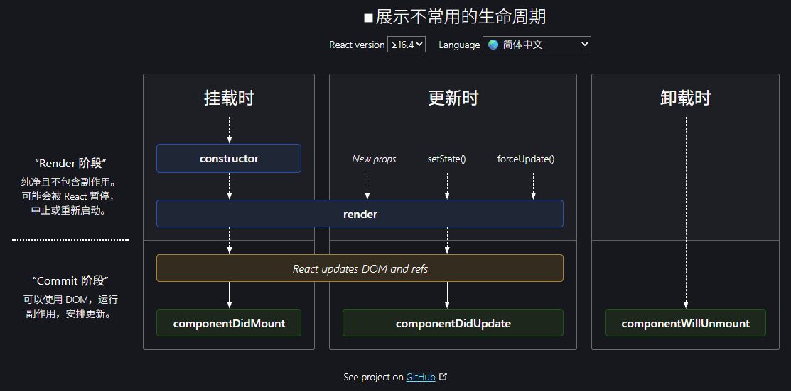
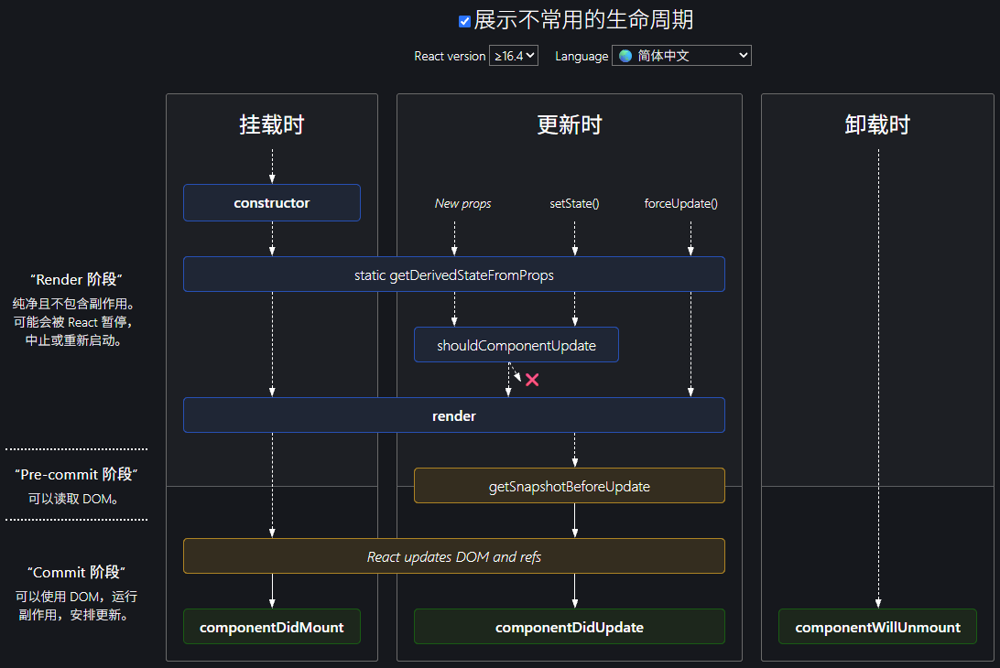
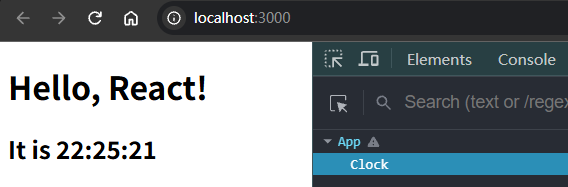

# Ch1S6P06：React 生命周期

> 本章概要：
>
> - 什么是生命周期
> - 常用的生命周期钩子函数


## 1 何为生命周期

所谓生命周期，指的是组件从诞生到销毁会经历一系列的过程，该过程就叫做生命周期。

`React` 在组件的生命周期中提供了一系列的钩子函数（类似于事件），可以让开发者在函数中注入业务逻辑代码，让它们在适当的时候运行。

**生命周期钩子函数是 【类组件】所独有的东西**，但是从 `React 16.8` 推出 `Hooks` 以来，整体已经开始以函数组件为主，因此这里仅介绍一些常用的生命周期钩子函数。

完整的生命周期图谱，可以参阅官网：[https://projects.wojtekmaj.pl/react-lifecycle-methods-diagram/](https://projects.wojtekmaj.pl/react-lifecycle-methods-diagram/)，或者查看该图解 [GitHub 仓库](https://github.com/wojtekmaj/react-lifecycle-methods-diagram)。



详细版：




## 2 常用的生命周期钩子函数

有关生命周期钩子函数的介绍，可以参阅官网：[API 参考：React.Component](https://zh-hans.reactjs.org/docs/react-component.html)

官网中在介绍这些钩子函数时，也是分为了 **常用** 和 **不常用** 两大类。

常用的生命周期钩子函数如下：

- `constructor`
  - 同一个组件对象 **只会创建一次**；
  - 不能在第一次挂载到页面之前，调用 `setState`，为了避免问题，构造函数中严禁使用 `setState`；

- `render`
  - `render` 是整个类组件中 **必需** 的生命周期方法；
  - 返回一个虚拟 `DOM`，会被挂载到虚拟 `DOM` 树中，最终渲染到页面的真实 `DOM` 中；
  - `render` 可能不只运行一次，只要需要重新渲染，就会重新运行
  - 严禁使用 `setState`，因为可能会导致无限递归渲染；

```react
import React from "react";

// 类组件
class App extends React.Component {
  constructor() {
    super();
    // 主要做一些初始化操作，例如该组件的状态
    this.state = {
      value : 1
    }
    console.log("constructor");
  }

  clickHandle=()=>{
    this.setState({
      value : this.state.value + 1
    })
  }

  render() {
    console.log("render");
    return (
      <div>
        <div>{this.state.value}</div>
        <button onClick={this.clickHandle}>+1</button>
      </div>
    )
  }
}

export default App;
```

- `componentDidMount`
  - 类似于 `Vue` 中的 `mounted`
  - 只会执行一次
  - 可以使用 `setState`
  - 通常情况下，会将网络请求、启动计时器等一开始需要的操作，书写到该函数中
- `componentWillUnmount`
  - 通常在该函数中销毁一些组件依赖的资源，比如计时器（参考 [核心概念：5. State & 生命周期](https://zh-hans.legacy.reactjs.org/docs/state-and-lifecycle.html) 中的时钟案例）

本地实测 `Clock` 组件代码详见 `code/diy/clock/`：

```react
class Clock extends Component {
  constructor(props) {
    super(props);
    this.state = {
      date: new Date(),
    };
  }

  tick = () => {
    this.setState({
      date: new Date(),
    });
  };

  componentDidMount() {
    this.timerID = setInterval(this.tick, 1000);
  }

  componentWillUnmount() {
    clearInterval(this.timerID);
  }

  render() {
    return (
      <>
        <h1>Hello, React!</h1>
        <h2>It is {this.state.date.toLocaleTimeString()}</h2>
      </>
    );
  }
}
```




## 3 文档阅读任务

- [API 参考：React.Component](https://zh-hans.legacy.reactjs.org/docs/react-component.html)（旧版，已另存为 `doc1_react_component.md`）
- [过时的 React API：Component](https://zh-hans.react.dev/reference/react/Component)（新版，由于包含在线示例，不方便另存为离线文档）

