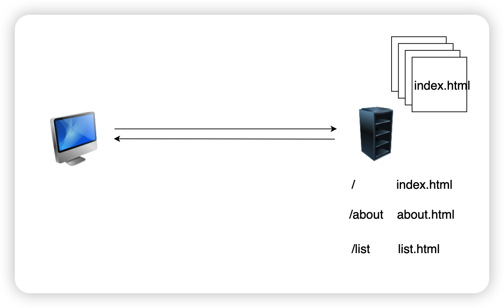
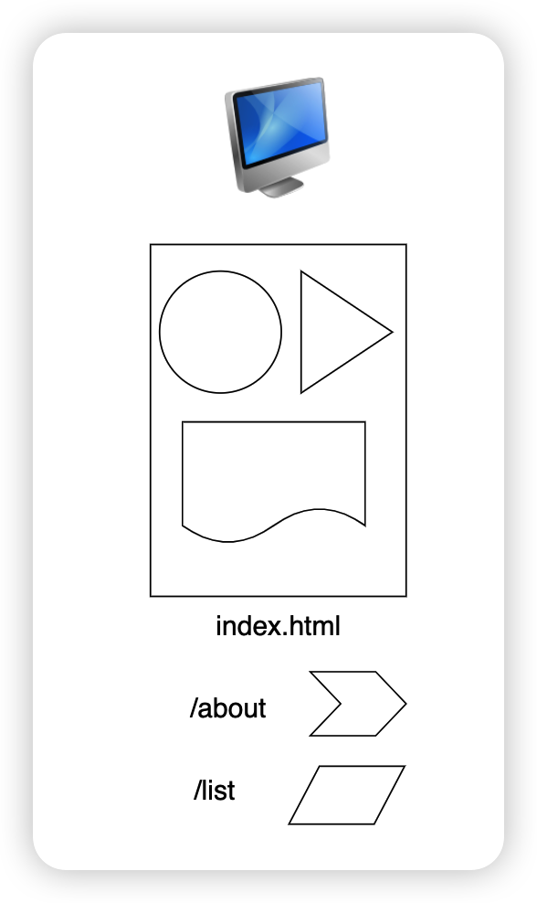
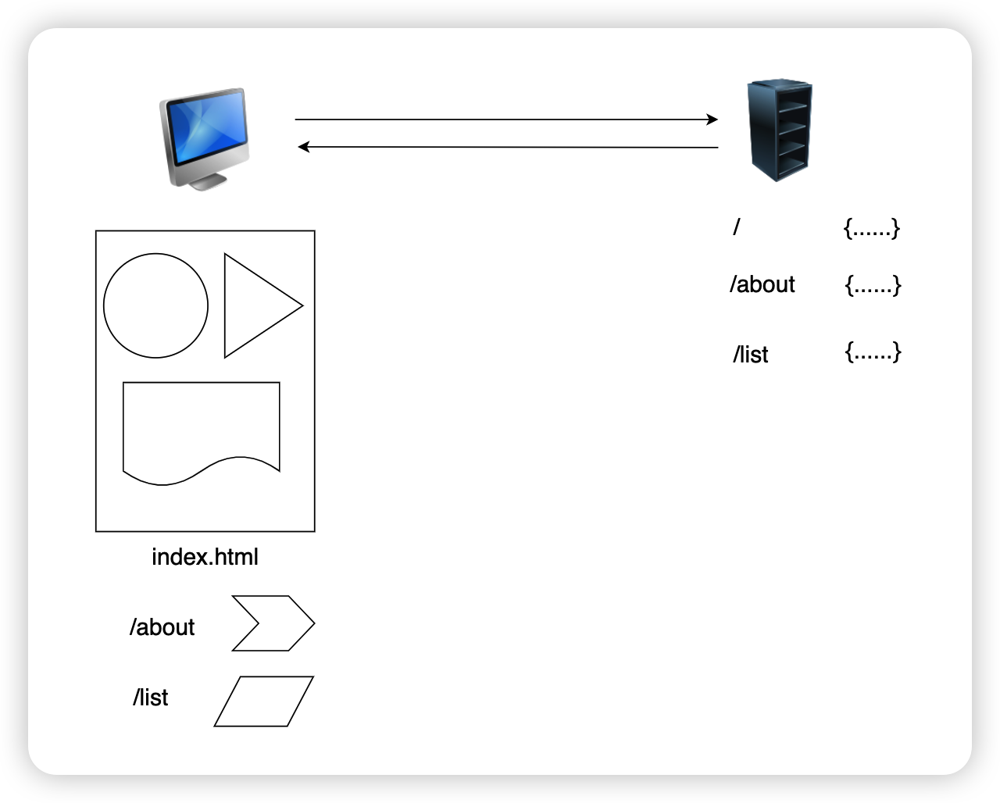

# Ch2S1P08：React-Router 简介

---

> 本节概要：
>
> - 前端路由概念
> - `React Router`（v6）


## 1 前端路由概念

早期并不存在前端路由，那时只有后端路由：



后来，随着单页应用的流行，整个 `Web` 应用只存在一个页面，通过 `JS` 调整模块来显示不同的内容：



可以看到，所谓前端路由实际上就是 **协调当前页面显示什么模块**。

那么，单页应用时代还存在后端路由吗？

实际上也是存在的，后端路由负责返回 **对应的数据**：




## 2 React-Router

`React Router` 是 `React` 官方所推出的前端路由库，官网地址：[https://reactrouter.com/en/main](https://reactrouter.com/en/main)（`2026-11-17` 已更新为：[https://reactrouter.com/home](https://reactrouter.com/home)）

目前最新的版本为 `v6` 版本（学习时已更新至 `v8.5.1`）。相比之前的版本，该版本变化略大，加入了许多新的 `Hook`，比如 `useRoutes`（详见最新 [官方文档](https://reactrouter.com/api/hooks/useRoutes)）就提供了类似于 `Vue-Router` 相似的特性，从而使用起来更加方便：

```react
import { useRoutes } from "react-router";

function App() {
  let element = useRoutes([
    {
      path: "/",
      element: <Dashboard />,
      children: [
        {
          path: "messages",
          element: <DashboardMessages />,
        },
        { path: "tasks", element: <DashboardTasks /> },
      ],
    },
    { path: "team", element: <AboutPage /> },
  ]);

  return element;
}
```

整个官网可以分为几大块：

- `Routers`：当前支持创建的路由类型
  - `createBrowserRouter`：即 `History` 模式
  - `createHashRouter`：即 `Hash` 模式
  - `createMemoryRouter`：在内存中管理自己的历史记录栈，常用于移动端（不存在浏览器导航）
- `Components`：支持的内置路由组件（不会逐一讲解，示例项目用到什么讲什么）
- `Hooks`：各类钩子函数
- 各类 `API` 函数：如 `Fetch Utilities` 和 `Utilities` 板块

整个 `React Router` 章节将创建一个 **学生管理系统**，用到什么讲什么。

