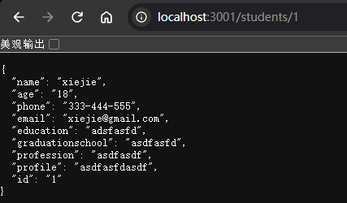
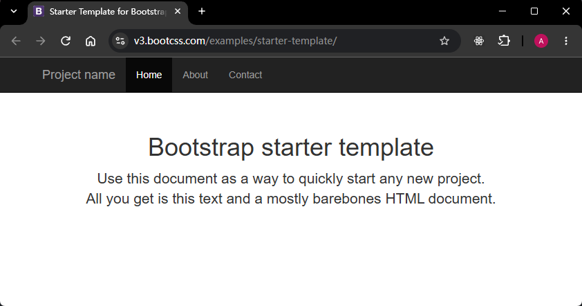
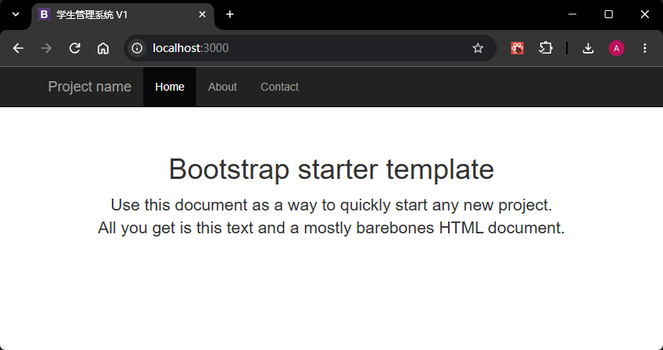
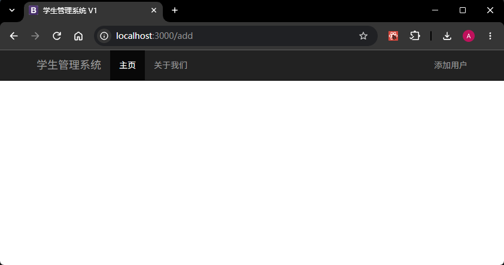
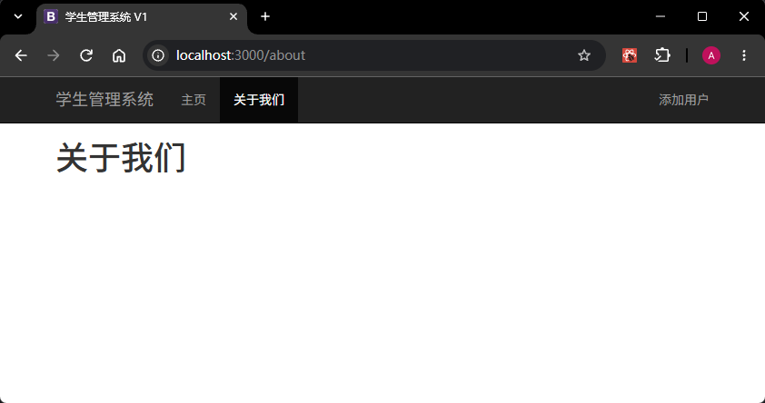
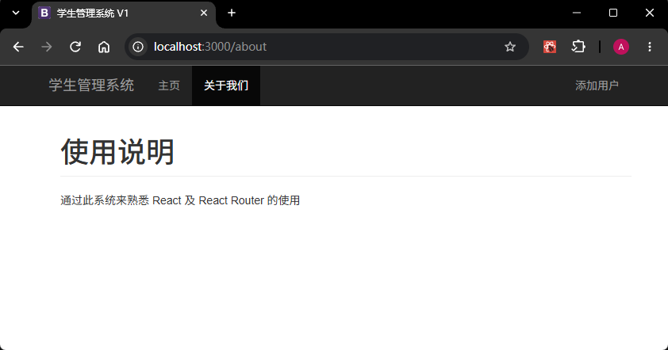
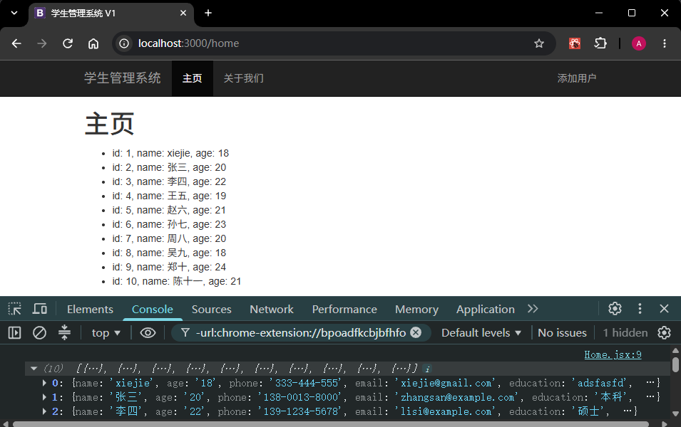
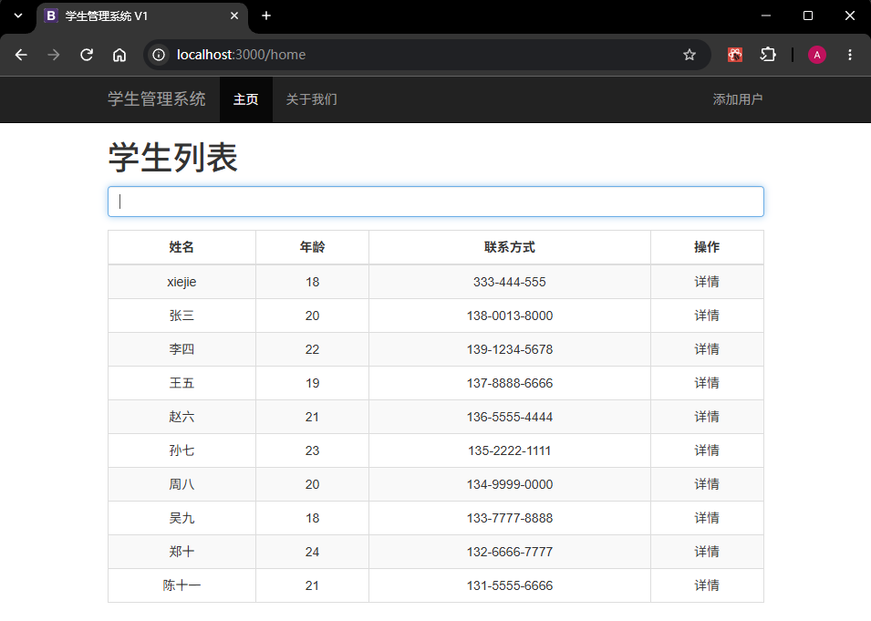

# Ch2S2P09：搭建学生管理系统骨架

---

> **本节概要**
>
> - 基于 `React Router` 和 `Bootstrap` 快速搭建空白示例项目


## 1 快速搭建服务器

选用 `json-server`（详见 [NPM 文档](https://www.npmjs.com/package/json-server)）快速搭建本地服务器。

具体操作：

```powershell
cd stu-admin/server
npm init # follow the guidance
npm i json-server
ni -Type File -Name db.json | Out-Null
# Copy data into db.json file
# Add npm-run script (package.json, PORT: 3001): "start": "json-server --watch db.json --port 3001"
# Launch the server
```

`db.json`：

```json
{
  "students": [
    {
      "name": "xiejie",
      "age": "18",
      "phone": "333-444-555",
      "email": "xiejie@gmail.com",
      "education": "adsfasfd",
      "graduationschool": "asdfasfd",
      "profession": "asdfasdf",
      "profile": "asdfasfdasdf",
      "id": 1
    },
    {
      "name": "yajing",
      "age": "34",
      "phone": "123-345-678",
      "email": "yajing@hotmail.com",
      "education": "fasdfasfd",
      "graduationschool": "fasfasdf",
      "profession": "sdfasdfafd",
      "profile": "asdfasdf",
      "id": 3
    },
    {
      "name": "xizhi",
      "age": 47,
      "phone": "13112341234",
      "email": "1234567@qq.com",
      "education": "硕士",
      "graduationschool": "北京大学",
      "profession": "前端开发工程师",
      "profile": "大家好!",
      "id": 2
    }
  ],
  "classes": [
    {
      "id": 1,
      "name": "前端01班",
      "description": "这是一个积极向上的班级"
    },
    {
      "id": 2,
      "name": "前端02班",
      "description": "这也是一个非常积极向上的班级"
    }
  ]
}
```

在 `package.json` 中添加启动命令：

```json
{
  "scripts": {
    "start":"json-server --watch db.json --port 3001"
  }
}
```

注意：

- `--port PORT`：端口默认为 `3000`，为避免与客户端冲突改为 `3001`；
- 根据命令行提示，最新 `json-server` 已自带 `--watch` 参数，可省略：`"json-server db.json --port 3000"`

打开浏览器进行验证（http://localhost:3001/students/1）：




## 2 快速搭建整个管理系统

### 2.1 引入 Bootstrap 基础模板

课程选用 `Bootstrap V3` 的 [入门级模板](https://v3.bootcss.com/examples/starter-template/) 快速搭建了一个示例页：



因为用到了与 `Bootstrap` 相关的样式类，所以需要引入 `Bootstrap` 的 `CSN` 资源、`CSS` 文件、依赖的 `jQuery` 资源：

`CDN` 地址（`Bootstrap v3.4.1`）：[https://www.bootcdn.cn/twitter-bootstrap/](https://www.bootcdn.cn/twitter-bootstrap/)

可以在 `index.html` 中添加如下的代码：

```html
<!-- 最新版本的 Bootstrap 核心 CSS 文件 -->
<link
  rel="stylesheet"
  href="https://cdn.jsdelivr.net/npm/bootstrap@3.3.7/dist/css/bootstrap.min.css"
  integrity="sha384-BVYiiSIFeK1dGmJRAkycuHAHRg32OmUcww7on3RYdg4Va+PmSTsz/K68vbdEjh4u"
  crossorigin="anonymous"
/>

<!-- 引入 jQuery -->
<script src="https://cdn.bootcss.com/jquery/1.12.4/jquery.min.js"></script>
<!-- 最新的 Bootstrap 核心 JavaScript 文件 -->
<script
  src="https://cdn.jsdelivr.net/npm/bootstrap@3.3.7/dist/js/bootstrap.min.js"
  integrity="sha384-Tc5IQib027qvyjSMfHjOMaLkfuWVxZxUPnCJA7l2mCWNIpG9mGCD8wGNIcPD7Txa"
  crossorigin="anonymous"
></script>
```

---

实测 `Bootstrap V3` 时，使用 [官方 GitHub 仓库 v3.4.1 分支](https://github.com/twbs/bootstrap/tree/v3.4.1) 下的原始示例页进行修改，这是修改后的 `index.html`：

```html
<!doctype html>
<html lang="en">
  <head>
    <meta charset="utf-8">
    <meta http-equiv="X-UA-Compatible" content="IE=edge">
    <meta name="viewport" content="width=device-width, initial-scale=1">
    <!-- The above 3 meta tags *must* come first in the head; any other head content must come *after* these tags -->
    <meta name="description" content="">
    <meta name="author" content="">
    <link rel="icon" href="favicon.ico">

    <title>学生管理系统 V1</title>

    <!-- Bootstrap core CSS -->
    <link href="./css/bootstrap.min.css" rel="stylesheet">

    <!-- IE10 viewport hack for Surface/desktop Windows 8 bug -->
    <link href="./css/ie10-viewport-bug-workaround.css" rel="stylesheet">

    <!-- Custom styles for this template -->
    <link href="./css/starter-template.css" rel="stylesheet">

    <!-- Just for debugging purposes. Don't actually copy these 2 lines! -->
    <!--[if lt IE 9]><script src="../../assets/js/ie8-responsive-file-warning.js"></script><![endif]-->
    <script src="./js/ie-emulation-modes-warning.js"></script>
  </head>

  <body>

    <div id="root"></div>

    <!-- Bootstrap core JavaScript
    ================================================== -->
    <!-- Placed at the end of the document so the pages load faster -->
    <script src="./js/jquery-1.12.4.min.js"></script>
    <script src="./js/bootstrap.min.js"></script>
    <!-- IE10 viewport hack for Surface/desktop Windows 8 bug -->
    <script src="./js/ie10-viewport-bug-workaround.js"></script>
  </body>
</html>
```

实测效果（`code/diy/stu-admin-blank-bootstrap-v3/client/`）：



精简后的版本（`App.jsx`）：

```react
function App() {
  return (
    <>
      <nav className="navbar navbar-inverse navbar-fixed-top">
        <div className="container">
          <div className="navbar-header">
            <button type="button" className="navbar-toggle collapsed" data-toggle="collapse" data-target="#navbar" aria-expanded="false" aria-controls="navbar">
              <span className="sr-only">Toggle navigation</span>
              <span className="icon-bar"></span>
              <span className="icon-bar"></span>
              <span className="icon-bar"></span>
            </button>
            <a className="navbar-brand" href="/">学生管理系统</a>
          </div>
          <div id="navbar" className="collapse navbar-collapse">
            <ul className="nav navbar-nav">
              <li className="active"><a href="/home">主页</a></li>
              <li><a href="/about">关于我们</a></li>
            </ul>
            <ul className="nav navbar-nav navbar-right">
              <li><a href="/add">添加用户</a></li>
            </ul>
          </div>
        </div>
      </nav>
    </>
  );
}

export default App;
```

效果（详见 `code/diy/stu-admin-no-router/client/`）：




### 2.2 引入 React Router

添加依赖：

```powershell
# 原始命令
npm i react-router axios
# 实测时要带上版本（最新 cra 已默认使用 React 19）
npm i react-router@7 axios@1
```

在 `App.jsx` 中引入 `React Router` 相关组件：

```react
import {Routes, Route, Navigate, NavLink} from 'react-router-dom';
import Home from './components/Home';
import About from './components/About';
import Add from './components/Add';

import './css/App.css';

function App() {
  return (
    <div id="app" className="container">
      <nav className="navbar navbar-inverse navbar-fixed-top">
        <div className="container">
          <div className="navbar-header">
            <a className="navbar-brand" href="/">学生管理系统</a>
          </div>
          <div id="navbar" className="collapse navbar-collapse">
            <ul className="nav navbar-nav">
              <NavLink to="/home">主页</NavLink>
              <NavLink to="/about">关于我们</NavLink>
            </ul>
            <ul className="nav navbar-nav navbar-right">
              <NavLink to="/add">添加用户</NavLink>
            </ul>
          </div>
        </div>
      </nav>
      <Routes>
        <Route path='/home' element={<Home />} />
        <Route path='/about' element={<About />} />
        <Route path='/add' element={<Add />} />
        <Route path='/' element={<Navigate to="/home" replace={true} />} />
      </Routes>
    </div>
  );
}

export default App;
```

同时在 `index.js` 中用 `BrowserRouter` 包裹 `App` 组件：

```react
import ReactDOM from "react-dom/client";
import App from "./App";
import { BrowserRouter } from "react-router-dom";

const root = ReactDOM.createRoot(document.getElementById("root"));
root.render(
  <BrowserRouter>
    <App />
  </BrowserRouter>,
);
```

再调整细节样式 `src/css/App.css`：

```css
.navbar-nav a {
  text-decoration: none;
  display: inline-block;
  padding: 15px;
  color: #9d9d9d;

  &.active {
    color: #fff;
    background-color: #080808;
  }
  &:hover {
    color: #fff;
    background-color: transparent;
  }
}
```

实测效果（详见 `code/diy/stu-admin-with-router/client/`）：




### 2.3 实现【关于我们】内容渲染

纯文字展示，无页面交互逻辑：

```react
function About() {
  return (
    <div className="container about">
      <h1 className="page-header">使用说明</h1>
      <p>通过此系统来熟悉 React 及 React Router 的使用</p>
    </div>
  );
}

export default About;
```

实测效果（详见 `code/diy/stu-admin-with-router-about/client/`）：




### 2.4 实现【主页】内容渲染

新增数据接口模块（`src/api/`）：

```js
// src/api/request.js
import axios from "axios";

const request = axios.create({
  // backend mock API
  baseURL: "http://localhost:3001",
  timeout: 5000,
});

// 设置请求拦截
request.interceptors.request.use((req) => {
  /* -- snip -- */
});

// 设置响应拦截
request.interceptors.response.use((res) => {
  /* -- snip -- */
});

export default request;

// src/api/stuApi.js
import request from "./request";

export function getStuListApi() {
  return request.get("/students");
}
```

在 `src/components/Home.jsx` 中引入 `useState` 与 `useEffect` 函数，完成主页初步渲染：

```jsx
import { useState, useEffect } from "react";
import { getStuListApi } from "../api/stuApi";

function Home() {
  const [stuList, setStuList] = useState([]);
  useEffect(() => {
    const fetchData = async () => {
      const { data } = await getStuListApi();
      console.log(data);
      setStuList(data)
    };
    fetchData()
  }, []);
  return (
    <>
      <h1>主页</h1>
      <ul>
        {stuList.map((item) => (
          <li key={item.id}>
            id: {item.id}, name: {item.name}, age: {item.age}
          </li>
        ))}
      </ul>
    </>
  );
}

export default Home;
```

实测效果（详见 `code/diy/stu-admin-with-router-home/client/`）：




### 2.5 完善【主页】：绘制无交互的表格

根据 `2.4` 节实现的功能，将主页内容修改为渲染一个带姓名搜索框的表格（暂不支持动态检索姓名）：

```jsx
import { useState, useEffect } from "react";
import { getStuListApi } from "../api/stuApi";

function Home() {
  const [stuList, setStuList] = useState([]);
  const [query, setQuery] = useState("");

  useEffect(() => {
    const fetchData = async () => {
      const { data } = await getStuListApi();
      setStuList(data);
    };
    fetchData();
  }, []);

  function handleQueryChange(e) {
    setQuery(e.target.value.trim());
  }

  return (
    <>
      <h1>学生列表</h1>
      {/* 搜索框 */}
      <input
        type="text"
        value={query}
        onChange={handleQueryChange}
        className="form-control"
      />

      {/* 数据列表 */}
      <table className="table table-striped table-bordered">
        <thead>
          <tr>
            <th>姓名</th>
            <th>年龄</th>
            <th>联系方式</th>
            <th>操作</th>
          </tr>
        </thead>
        <tbody>
          {stuList.map(({ id, name, age, phone }) => (
            <tr key={id}>
              <td>{name}</td>
              <td>{age}</td>
              <td>{phone}</td>
              <td>详情</td>
            </tr>
          ))}
        </tbody>
      </table>
    </>
  );
}

export default Home;
```

实测效果（详见 `code/diy/stu-admin-with-router-home-table/client/`）：



> [!note]
>
> **注意**
>
> `useEffect` 的第二个参数要写为 `[]` 以免循环调用后端数据接口。
