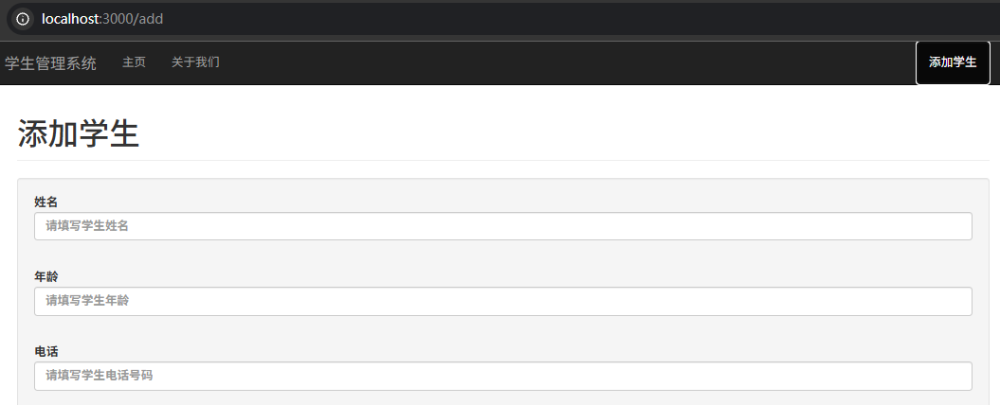
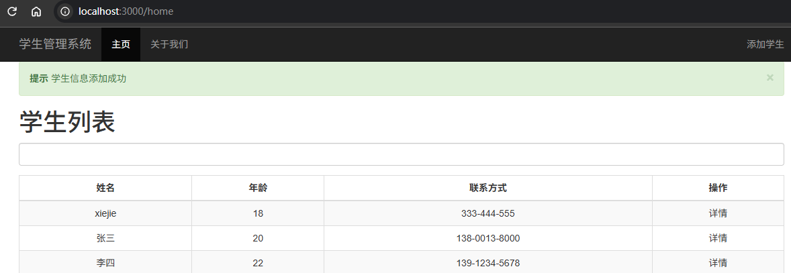
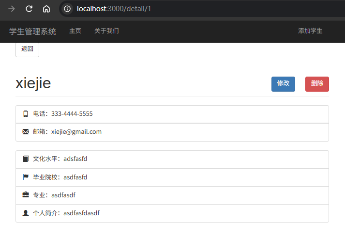

# Ch2S3P10：完善学生管理系统


> **本节概要**
>
> 实现学生管理系统基本的 `CRUD` 操作逻辑。


## 1 实现添加学生

需求：点击【添加学生】，进入添加页面，提交表单后跳转到列表页。

效果（详见 `code/diy/stu-admin-add_filter`）：





注意事项：

提示框（`Alert` 组件）使用自定义 `Hook`：

```jsx
import Alert from "../components/Alert";
import { useEffect, useState } from "react";
import { useLocation } from "react-router-dom";

export default function useAlert() {
  const [alert, setAlert] = useState(null);
  const location = useLocation();
  useEffect(() => {
    if (location.state) {
      setAlert(location.state);
    }
  }, [ location ]);
  return alert ? <Alert {...alert} /> : null;
}
```

学生列表也实现了自定义 `Hook`（没有单独创建 `qryList` 状态，较原视频更好）：

```jsx
// src/hooks/useStudentList.js

import { useEffect, useState } from "react";
import { getStuListApi } from "../api/stuApi";

export default function useStudentList() {
  const [stuList, setStuList] = useState([]);
  const [query, setQuery] = useState("");

  useEffect(() => {
    (async () => {
      const { data } = await getStuListApi();
      setStuList(data);
    })();
  }, []);

  const dataList = query
    ? stuList.filter((student) => student.name.match(query))
    : stuList;

  function handleQueryChange(e) {
    setQuery(e.target.value.trim());
  }

  return { dataList, query, handleQueryChange };
}
```


## 2 实现单条数据的详情渲染、修改和删除操作

效果图：



实测笔记：

- 将 `CDN` 样式下载到本地后，远程引用的字体文件也要同步下载，否则字符图标无法正常渲染；
- 由于添加和修改页是同一组件，用 `useEffect` 获取单个学生信息时，两种情况都要考虑：
  - 有 `id`：正常查询后赋值；
  - 无 `id`：赋默认的空值（防止修改页面点击添加，导致表单未清空）；
- 要让 `navigate` 携带路由数据，第二参数中的 `state` 键为固定写法：`navigate("/home", {state: {type: "info", content: "..."}})`；
- `navigate` 传参可通过 `location.state` 获取。